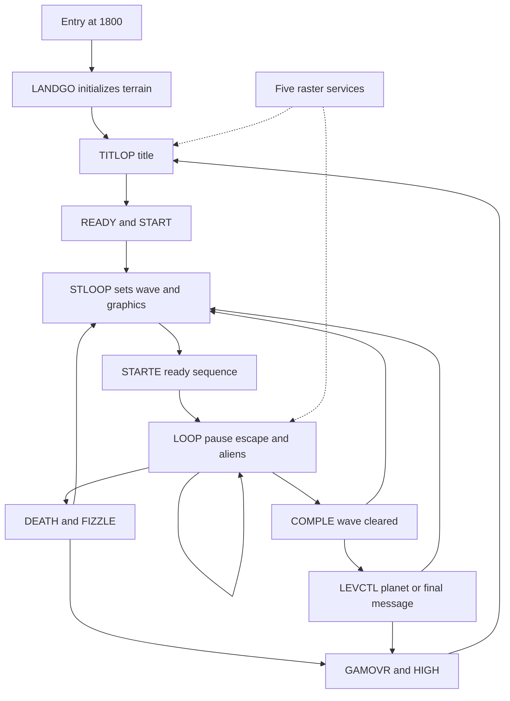

# Xargon's Revenge – Codebase Analysis

## Purpose and Evidence

I use this analysis to learn from the restored game, change it deliberately and plan versions for other platforms. The baseline is the source and object-listing revision. All 8,094 bytes at `$1800`–`$379D` match the surviving object records. The standalone graphics selected by the original loader complete the build without copying executable bytes or assets from the running reference.

I distinguish source instructions, captured execution, source comments and proposals. The title and first gameplay loop were exercised in VICE on a 16 KB PAL C16. Forty-eight isolated observations test selected original routines. Later transitions and the complete game have not been played through. Descriptions below of those paths come from the source, not a claim that I exercised them.

The [generated code reference](docs/analysis/CODE_REFERENCE.md) gives logical module-line numbers and addresses. [codebase-index.json](docs/analysis/codebase-index.json) contains definitions, variable sizes, module allocations and direct transfers. [asset-data.json](docs/analysis/asset-data.json) exports the graphics and data tables. The [validation report](docs/SOURCE_AND_VALIDATION.md) establishes which bytes and behaviour were checked.

---

## Architecture and Reading Map

The game has a foreground control flow and five raster services. The foreground builds the title, starts a session, updates aliens and handles death and completion. Raster services scan controls, scroll terrain, move the ship and projectile, update fuel, animate characters, service sound and draw stars. This is not a single update function called once per display frame.

The arrows show selected paths. They omit interrupts between instructions, nonlocal returns, indirect data-driven control and some title subpaths. I start reading with `REVENGE`, `VARS`, `MAIN-VARS` and `PLAY-GAME`, then `IRQ` and `RASTER-ROUTINES`. I follow `SET-SHEET`, `INIT-SHEET` and `ALIEN-CODE` before changing a wave. The code reference lists the full assembly order; file order in a host directory is irrelevant.

---

## Memory, State and Allocation

| Range         | Role                                |
| ------------- | ----------------------------------- |
| `$0002–$00FD` | 252 bytes of zero-page state        |
| `$0100–$01FF` | CPU stack                           |
| `$0200–$020F` | `ALICOL`, sixteen alien attributes  |
| `$0210–$021F` | `STARSP`, sixteen star speeds       |
| `$0220–$02BF` | `BIGBUF`, shared 160-byte workspace |
| `$0400–$07FF` | `ALDATA`, sixteen 64-byte designs   |
| `$0800–$0BE7` | Visible character attributes        |
| `$0C00–$0FE7` | Visible 40 × 25 character matrix    |
| `$1000–$17FF` | Terrain glyph bank                  |
| `$1800–$379D` | Code and embedded tables/text       |
| `$379E–$37FF` | Output padding                      |
| `$3800–$3FFF` | Font and writable runtime glyphs    |
| `$FD30`       | Keyboard row selection              |
| `$FF00+`      | TED registers and banking control   |

`EXTRA-MEMORY` reserves 192 bytes at `$0200`, not the much larger free region mentioned in its comments. `BIGBUF` serves different phases: explosion generation and the ship's death mask reuse it. Treating every comment about possible free memory as an allocation would be unsafe.

`VARS` allocates sequentially from `$0002`. `TITLE`, `STOP`, `PAUSE`, `STPSTR`, `KILLCO`, `DNTFIR`, `CTLFUL` and `VOLCTL` gate different work; they are not interchangeable pause flags. `SCRBUF` at `$0087` holds eight numeric decimal digits, most significant first. `RND` at `$0025` is four bytes. `IRQWRK` at `$0033` and `WORK` at `$003B` are separate eight- and ten-byte scratch areas, but other shared globals still cross execution contexts.

The sixteen-entry arrays are `ALIXPS` at `$009E`, `ALIYPS` at `$00AE`, `ALIIND` at `$00BE` and `ALSTAT` at `$00CE`. `STARXP` and `STARYP` follow at `$00DE` and `$00EE`. The exact adjacency follows from source order and matters to indexed operations. On the tested 16 KB machine, CPU writes to `$FFFA`–`$FFFF` mirror to physical RAM `$3FFA`–`$3FFF`, overlapping the last font glyph. The gameplay capture contains the installed reset/NMI and IRQ vectors there. An initial font atlas therefore differs from runtime RAM even when that glyph is not being drawn. State is mutable RAM even when a label sits beside executable bytes: `SNDFLG` and `JOYSEL` are initialized bytes at `$1823` and `$1824`.

---

## Entry, Reset and Session State

At `$1800`, `REVENGE` disables interrupts, sets the stack pointer to `$FE`, banks the KERNAL out through `$FF3F`, points `MESL` at the scrolling message, clears terrain counters and calls `LANDGO`. It selects character data from RAM through TED register 18 and jumps to `TITLOP`.

The modern PRG loads all selected memory at `$0400`. That is a packaging choice for the restored build, not a new instruction inserted ahead of the game. The original autobooter loaded object code and separate assets; its relocation loader moved `BJH` from the screen loading area to `$0400`. The supplied compressed running PRG instead begins with a BASIC `SYS 4109` stub and reaches the same `$1800` entry after unpacking.

`CLVARS` clears zero page `$12`–`$FF`, leaving the earlier scrolling and message state intact. The title calls it and initializes stop, title, message and terrain-speed flags. `SETIRQ` installs `SERV` in the RAM IRQ vector and `RESET` in both reset and NMI vectors. The reset handler is a deliberate animated warning loop, not a clean return to BASIC; its old ROM-return instructions are commented out.

`START` initializes the ship at `SHIPY = 7`, `YPIX = 3`, screen address `$0DB9`, sets debounce and fuel tempos, starts with five lives and requests 111 fuel units. `REPLAY` resets sheet and level counters; `STLOOP` sets up the current wave, installs its alien graphics, redraws the display, prints the ship and runs the ready sequence. Re-entry after death goes to `STLOOP`, so it does not start a completely new session or clear the score.

The packaging says three lives. The source instruction and running reference both set five. `PRLIVE` caps the selected icon position at three while continuing its loop, so extra lives are not represented by additional icons. I preserve that distinction.

---

## Title, Messages and Menus

`TITLOP` calls `TITTOP`, starts interrupts and repeatedly chooses colours, clears the title window, scrolls in the title and starts stars. `REVTIT` chooses an unused row randomly until all sixteen title rows have been processed. `ALIXPS` temporarily marks completed title rows; it is later reused as the alien X array.

`BANNER` contains sixteen rows of twenty packed bytes. Each nibble selects a title glyph: `CALCBY` adds 136 to a nonzero nibble and maps zero to space 32. `SCRLIT` chooses screen and data pointers from `SCRPOS` and `TIM20`, then scrolls a row from either side. It patches the immediate operand at `JOURNY+1` to change its comparison for the direction. `BRING`, `FADOFF` and `TITTER` all permit fire to leave the title; some title paths jump directly to `READY` from inside nested calls. `START` clears state rather than relying on those calls returning normally.

`ALTER` handles J/K and S/Q selections during title raster service, editing `TPBUFF` and `TPCOLS`. It displays keyboard/joystick, sound state and a high score. These are direct key selections, not a navigable menu tree. Sound initially uses `SNDFLG = 0`; joystick selection initially uses `JOYSEL = 1`.

`MESSAGE-STUFF` scrolls the credits and advertising text along row 24. Text strings have distinct encodings: some are ASCII masked with `$3F` for screen codes; title art uses packed nibbles; doubled letters and digits use explicit glyph tables. A port must identify the consuming routine before treating a byte array as ordinary text.

---

## Interrupt Scheduling and Timing

`SERV` preserves A, X and Y on the CPU stack, acknowledges TED IRQ bits and cycles `INTYPE` through five services. It computes three times the service index and patches the branch displacement at `BRAN+1`, selecting one of five adjacent `JMP` instructions. The zero case relies on the zero flag so that the branch falls through. Replacing the dispatcher without preserving both its flags and instruction spacing changes execution.

`RAST1` selects the upper terrain bank and fine scroll, sets the window background/border, scans controls and schedules raster compare `$21`. `RAST2` selects the playfield font at `$3800`, fixes the horizontal scroll and sets ship multicolours. Unless paused it updates top and bottom scrolling, the small terrain TV display, sound and terrain animation. Unless stopped it also drains/adds fuel and updates score and gauge. It processes title selections and the message, then schedules `$A2`.

`RAST3` selects bottom terrain fine scroll, bank and colours, moves the projectile when enabled and schedules `$C1`. `RAST4` selects the message bank and fine scroll, changes its background and schedules `$CB`. `RAST5` restores the status region's horizontal mode and colours, moves the fuel pod and player when enabled, advances stars and schedules `$11` for the next cycle.

Those compare values are TED raster register values. They are not direct indices into a 200-line screenshot. Delay loops around register changes are part of the display timing. I have not measured a complete cycle budget or established that a rearranged IRQ remains within it.

`RUSRAS` polls bit 0 of `$FF1C`, waiting for the high raster region transition. Alien foreground work calls it before processing the array, and many effects use it as a frame boundary. `DELAY+2` skips the instruction that normally sets X, letting callers supply the outer delay count. A fixed-rate native game loop would need to reproduce the separate raster, foreground and busy-wait timing domains deliberately.

---

## Input and Player Movement

`REDJOS` returns early under `KILLCO`. It selects keyboard or joystick through `JOYSEL`. Joystick scanning tries the first selection, then a second if the first yields no activity. It patches `XTRCDE` between opcode `$4A` (`LSR A`) and `$EA` (`NOP`) to align the fire bit for the selected port. `JUP`, `JDOWN` and `JFIRE` receive high-bit flags through rotations, while `JMOVE` records activity.

`KEYIT` selects a keyboard row through `$FD30` and `$FF08`, masks the column bits and returns carry set for a pressed key. The active table maps S, X and Return, consistent with the inlay; the old A/Z comments do not match its operands. The pause scan maps Space and resumes with G in the supplied VICE matrix; Escape aborts. Manual host mapping and both physical joystick ports remain untested.

`SHIP` runs in `RAST5`. It handles firing and vertical movement, erases the old twelve-cell footprint and calls `PRSHIP` to rebuild shifted character data. Movement changes `YPIX` by two, wraps it with `AND #7`, adjusts `SHIPY` when crossing a character boundary and moves the screen pointer by 40. The ship's horizontal footprint is fixed; terrain, stars, enemies and the projectile create relative horizontal motion.

The ship's coordinate representation is a character row plus an intra-character pixel phase. The initial odd phase 3 and two-pixel movement keep the ordinary sequence odd. `CHKSHP` has special tests for phases 0 and 6; those comments alone do not prove that those phases occur after ordinary startup. A derivative should preserve the observed source phase rules or explicitly choose a different alignment.

`SHPDT1` contains four consecutive 16-byte columns. `PRSHIP` clears 96 bytes at `$3BE0`, writes each source column into a 24-byte runtime column at the current phase, then prints the twelve codes in `SHPCHR` using `YSHIP`. This forms a four-by-three-cell footprint around 32-by-16-pixel artwork. Moving the player changes glyph RAM as well as screen pointers. The [phase GIF](docs/analysis/graphics/player-phases.gif) illustrates the phase order; its 250 ms delay is not a measured game cadence.

---

## World Construction, Terrain and Stars

The game does not store a complete scrolling level map. Top and bottom scenery are queues of character columns chosen procedurally from fixed motifs. `LANDGO` forces 41 block-scroll iterations to populate the initial bands. `TOPMVE` and `BOTMVE` subtract a fine-scroll amount and trigger a block shift when bit 3 indicates a cell boundary. Speed zero stops movement; speed one uses an alternating half-speed path; larger values subtract one before use. Top and bottom half-speed branches use opposite phases.

`TOPNEW` chooses one of eight four-column, two-row motifs at codes 192–255. `HARTOP` shifts rows 2 and 3 and writes the new column bottom glyph first, then top. `BOTNEW` chooses one of six eight-column, four-row motifs, beginning at codes 0, 32, 64, 96, 128 and 160. It rejects the previously used motif. `HARBOT` writes each stored column into four rows in reverse vertical order through `YHIL`. Storage order and screen order therefore differ.

`LANANI` replaces terrain glyphs 87 and 91 at `$12B8` and `$12D8` using four eight-byte frames from `CHR87` and `CHR91`. `LANDAN & $0C` selects the frame, making each last multiple updates. `TVPIC` shifts and modifies selected terrain bytes at `$1530` and `$1550` based on player height and direction. These are runtime changes inside the terrain bank, not independent hardware sprites.

The star field has sixteen entries. Despite the “3-speed” comment, `STARSP` stores values 0–3 and `STARS` derives speeds 1–4. `STARXP` uses horizontal sub-cell units: dividing by four selects a character column and the low two bits select codes 102–105. Stars draw only into spaces or existing star cells and only clear cells still carrying star codes. Other objects therefore influence star visibility without a separate compositing buffer.

---

## Waves, Alien State and Movement Patterns

`SHTABL` has sixteen eight-byte records: a little-endian movement pointer, three terrain colour bytes, background and two unused bytes. `SET-SHEET` seeds `RND` from TED, installs the record and initializes sixteen aliens with random positions, pattern offsets, attributes and animation bits. X starts in columns 14–39, Y in rows 0–13 and the initial movement index in 0–7.

The normal kill quotas in `TOKILL` are 24, 24, 32, 32, 48 and 48 across six level indices. The first level's first sheet uses sixteen instead. Half the sheet index is added to that quota, and `REGEN = NUMALI - 16` determines replacement aliens. `MPGVIL` holds fuel-drain tempos 28, 24, 20, 18, 16 and 14. Alien movement interval `ALISPD` changes from eight to five across each group of four sheets.

`ALIENS` waits at `RUSRAS`, decrements `ALTEM` and decides whether to move or just redraw/check collisions. Each slot copies position into `ALX/ALY`. `ALSTAT = $FF` means gone; bit 7 marks an explosion; otherwise bit 0 selects one of the two four-glyph frames. Active attributes are generated with bit 3 clear, so ordinary aliens use hires glyph interpretation even within the multicolour playfield.

Movement bytes combine bits 1, 2, 4 and 8 for up, right, down and left. Multiple bits can act in order in one update. Pattern streams end with `$FF`; the index resets when the next byte is the terminator. Up and down clamp; right stops at column 39, while left wraps from below zero to column 39. These asymmetries are implemented rules, not a symmetric vector model.

`RUBALI` clears the old two-by-two footprint. `PRTALI` writes four descending character codes and sets `HITIT` if the cells it covers contained laser code 63. It does not restore a saved background. The model and screen cell contents are tightly coupled, and iteration order can affect overlapping objects.

`NEWALI` decrements `REGEN`, respawns at X 38 when allowed, or removes its caller's return address with two `PLA` instructions and jumps back into alien iteration. It is unsafe to call this as an ordinary independent function. `UPEXPL` can likewise jump into completion instead of returning normally when the kill quota is met.

---

## Graphics Selection and the Running-Reference Difference

`ALIDEF` uses `CONVTB[SHEET & 15]` to select a 64-byte design from `ALDATA` and copies it to `$3EA8`–`$3EE7`. The sixteen designs occupy exactly 1,024 bytes at `$0400`. Each design is two frames of four glyphs; their display bases are codes 213–216 and 217–220. The source and loader-selected asset agree with every isolated selection probe.

The compressed running reference has the same executable instructions, terrain and font. Its first alien page is the same, but pages at `$0500`, `$0600` and `$0700` are shifted slices beginning at asset offsets 1, 2 and 3. The first four designs match; the twelve later selections differ in the original `ALIDEF` probes. I have not established the cause. I do not call those shifted pages an intentional design revision or quietly copy them into the preservation build.

The separate `O.ALI` MOS listing contains 1,024 bytes with its own checksums. It differs from `BJH` in 339 byte positions and from the unpacked reference pool in 765. This is an additional surviving graphics revision, not proof that its filename identifies the final asset. The autobooter's `BJH` dependency is the basis for the default choice. The source-data exports retain that choice explicitly.

---

## Projectile, Collision and Damage Contracts

`FIRE` allows one active projectile and refuses a new one if dead. It maps `YPIX / 2` through `PINK` and `FLOYD`, chooses a vertical cell and programs one full row in glyph 63 at `$39F8`. The projectile starts at X 4. `MVELAZ` clears its old cell, increments X, stops at 39 and writes the new glyph and attribute. `LAS` retains the last screen address so an alien hit can remove the shot.

`SHIP` compares current and previous fire flags to require release between shots. It updates `OLDFIR` only on the firing path, and compares the whole byte, including input history shifted in by the scanners. The release comment therefore does not establish a conventional boolean edge detector. Controlled calls with `OLDFIR = $80` reject `JFIRE = $80` but accept `$C0`; normal held-button cadence still needs an input trace. `FIRCNT` supplies an additional gate, but its initialized/reset value of one is not a long automatic-repeat timer. Every second shot calls `SHOTFL`, sharing the fuel decrement path with normal fuel drain.

`CHKSHP` reads the screen cells under the ship footprint before writing it. Values below 179 are ignored. Values 179–185 request fuel collection. Values 186–220 set `DEAD`. Values 221 and above are ignored as explosion/effect cells. Those intervals include adjacent graphics contracts; replacing glyph codes without updating collision changes behaviour even if the picture looks right. Ordinary aliens occupy 213–220, fuel writes 180–185 and explosions occupy 221–236.

The phase-zero and phase-six special cases reduce the ship's checked rows. Other phases check the full footprint. The collision model is a screen-code test, not pixel-perfect overlap. Fuel collection exits the checking loop early; death continues through it. A port with independent rectangles needs a deliberate compatibility layer if it wants the same results.

---

## Score, Fuel and Difficulty

`SCORE` adds A to the units digit; `SCORE+2` skips `LDY #7`, allowing callers to supply the digit index. Digits are stored as values 0–9, not ASCII or packed BCD. A single-digit carry loop propagates toward lower indices. `SCORPT` selects doubled digit glyphs and animates colours, also changing the player's second multicolour.

Alien rewards use `ALSC1`, `ALSC2` and `ALSC3`, selected by `ATTAK` capped at seven. The rewards across those indices are 50, 75, 100, 150, 200, 250, 300 and 350. Thus the inlay's 50-point statement is a starting rule, not the whole source table. Fuel collection calls alternate score entries to add 250. Planet messages award 5,000 and an extra life. Completion converts remaining fuel using level-indexed `BONUNT` and `BONTEN`.

Extra-life logic tracks digit 3, the ten-thousands digit, through `XTRA`. The tested transitions 49,999 to 50,000 and 99,999 to 100,000 each award one life in both versions. Eight-digit overflow wraps the visible digits to zero; when Y underflows to `$FF`, the final absolute-indexed store writes one to `$0186`, in the stack page. A sentinel there was overwritten by the isolated overflow probe. This is a source arithmetic limit, not a safe general-purpose score API. I leave it unchanged and require a compatibility decision for a port.

`FUELDO` pauses drain while `FULINC` is nonzero or `CTLFUL` is set, decrements `FUTEM`, reloads from `MPGVAL` and calls `SHOTFL` when appropriate. `ADFUEL` adds one per service until the request is exhausted or fuel reaches 111. `UPFUEL` displays fourteen cells, rewrites a partial-bar glyph and selects red/yellow/green thresholds at 24 and 72.

A forced `SHOTFL` call with fuel one sets zero and death. A forced call with fuel zero wraps to 255 and does not set death. Those results were probed with interrupts disabled and controlled state. I have not established that the latter state can normally be reached through player input. Low fuel also changes the ship colour and starts a channel-one warning.

The moving pod is a separate `FULCOD` subsystem. It delays spawning, starts at X `$98`, derives a Y position and direction from TED and moves two horizontal units and three vertical pixels per service. It bounces near vertical bounds, programs shifted glyphs at `$3DA0` and prints a three-column, two-row footprint through `FUELYP`. Collection clears the pod, requests sixteen fuel units, scores 250 and starts an effect.

---

## Completion, Death and High Score

`COMPLE` gates firing, fuel drain and controls, clears projectile and pod state, increments `SHEET` and wraps after sixteen. It advances `LEVEL` and caps it at five when it reaches six. `ATTAK` is formed as `LEVEL * 16 + SHEET` for the completion text. The routine uses a short decimal-mode loop to form displayed digits, then returns to binary mode.

Completion draws a box, drains remaining fuel into points, slows scenery and moves the ship through controlled flags. It later builds a refill request from saved fuel, pending fuel and 32 extra units, then invokes `LEVCTL` when sheet zero is reached. Additions clear carry separately and use eight-bit storage; they are not an unbounded resource calculation.

The packaging advertises 96 levels and 16 waves, while the source's naming distinguishes sixteen sheets and six indexed difficulty levels. Five planet names are stored, despite a “6 planet names” comment: MAGNUM, KAYLIH, NEBULA, NILBEG and XARGON. `LEVCTL` uses the level boundary to choose messages and awards; at level five it goes to `ENDLVL`, whose fire/down loop restarts or ends. I have not played through the full progression, so I do not turn the advertised 96 into a verified count of completed playable waves.

`DEATH` stops movement, clears fuel and objects, invokes `FIZZLE`, decrements lives and restarts the current sheet with a full refill request if any remain. `FIZZLE` saves the 96-byte ship glyph area to `BIGBUF`, masks it with TED-derived noise and changes colours before fading it away. `GAMOVR` draws the large message, checks the score, flashes, waits and returns to the title.

`HIGH` compares numeric score digits against the ASCII digits held in `TPBUFF+32`. A strictly greater score replaces the in-memory record; ties do not. There is no disk save or persistent high-score API. The congratulatory print loop starts at X 38 while the declared `CONGRA` span is 38 bytes, so it reads one byte beyond that text span. This is a static boundary observation, not a claimed visible symptom verified in normal play.

---

## Sound, Randomness and Shared Context

`SFX` accepts an effect number in A: fire, explosion, low fuel, collection and player death. `FXNUMB` uses its low seven bits for channel-two effect state and bit 7 for the channel-one low-fuel warning. `REFRSH` runs in raster service, updates durations and tone/noise registers and combines `WELLY` volume with enable bits. `ENDN1` and `ENDN2` preserve the other channel's state. `VOLCTL` lets foreground completion own volume temporarily. I traced these writes; I have not listened to or validated their sound.

`RANDOM` combines TED registers, carry state and the four-byte `RND` pool with shifts, rotates and an additive loop. `NUM1T7` uses a weighted lookup, not a uniform rejection sampler. Randomness also comes directly from TED in spawning, attributes, terrain and fizzle masks. A seed alone is not enough to reproduce a run without the same timing and hardware reads.

`SERV` preserves CPU registers, but interrupt code and foreground routines share state beyond registers. The intended `WORK`/`IRQWRK` split helps some paths; it is not a general reentrancy guarantee. Score, random state, sprite flags and glyph RAM have more than one owner. I would audit instruction-level interleavings before moving work between foreground and interrupts or introducing nested services. The isolated probes use `SEI` and do not establish concurrency safety.

---

## Calling Conventions and Layout Constraints

There is no uniform ABI. `KEYIT` returns a pressed indication in carry. `STARXY` accepts a row in A and returns a screen pointer in `SL`, using Y as a table index. `XY` accepts X/Y coordinates and constructs `SCR` and the attribute pointer `COL`. `NUM1T7` preserves X through `XTEMP` but changes A, Y and the random state. `PRTALI` and `RUBALI` consume `ALX/ALY` and scratch pointers, not conventional argument registers.

`SCORE+2`, `DELAY+2`, `SHIPON`, `MVEALL`, `BONLIF` and `SHOTFL` are significant alternate entries. Some skip initial setup and depend on caller state. `NEWALI` and completion paths change the stack/control flow rather than returning normally. A transfer index is useful for finding them but cannot model that behaviour by itself.

Self-modifying sites include the IRQ branch at `BRAN`, joystick opcode `XTRCDE` and title comparison operand `JOURNY+1`. The source also rewrites embedded completion strings and the title/high-score buffer. These allocations require writable memory. No ROM or immutable-memory port can simply map the assembled region read-only.

Implicit contracts include four-glyph alien frames, the eight-byte wave stride, sixteen-element arrays, screen/attribute separation of `$0400`, thirty-two-byte alien-frame spacing, and character-code collision ranges. Keep adjacent dispatch `JMP`s three bytes each. A new label or padding inserted between tables or at an alternate entry can change meaning even when every symbolic reference still assembles.

---

## Dormant Material and Development Tools

`PLANETS` and `BLOB-MOVE` are available source modules but absent from the active `REVENGE` include tree. They refer to state such as `PLANON` that the active variable declarations do not allocate. `MVEMET` is an immediate `RTS`. I do not advertise those routines as working gameplay features or restore their calls speculatively.

The commented alien-data include is not an active dependency. `O.ALI`, older `ALIBUM` assets, `LANDSCAPE-1`, title design data and the editable terrain provide revision evidence. `BIG-PRINT`, `COLOUR-SETTER`, `DESIGNER`, `DOUBLE-GENERATOR`, `DOUBLE-WIDTH` and `COMPACTOR` are development utilities. `ASM.C64`, `EDITOR64`, disk command tools and loaders belong to the historical host environment. Their raw source or binary size is not the game's executable size.

The sound comment referring to “our mate Robbie” gives neither a surname nor a defined contribution. I retain it as a source comment, not a new authorship credit. My dated recollections and the recovery background are in [History and Credits](docs/HISTORY_AND_CREDITS.md).

---

## Generated Statistics and Their Limits

The current index finds 75 available source modules, 68 in the main assembly, 7,223 logical lines across those active original modules, 2,815 instruction statements, 682 active symbol definitions and 515 resolvable direct-transfer statements. The object region is 8,094 bytes. These are counts made by the generator, not execution profiles.

Logical line totals include comments, declarations and directives, including module boundaries; they differ from expanded assembly lines. Instruction counts count source statements, not unique reached instructions or CPU cycles. Symbols include data, constants and branch targets. Direct transfers include branches and constant-offset entries, but omit fall-through, runtime patches, vector dispatch and stack manipulation. All 515 operands resolve statically; that does not make the list a complete call graph.

Module byte allocations come from emitted ca65 listing program counters and must cover the whole object span without holes. They include strings and tables. Variable sizes come from explicit reservations. The 81 exported data spans end at the next greater active symbol address; aliases and embedded records still need source interpretation. Raw payloads retain byte order and record source module, logical line and hashes.

---

## Modification Map and Debugging Sequence

| Change                  | Start with                         |
| ----------------------- | ---------------------------------- |
| Starting lives          | `PLAY-GAME:START`, `PRLIVE`        |
| Ship speed/limits       | `MOVE-SHIP:SHIP`, `CHKSHP`         |
| Player artwork          | `SHPDT1`, `PRSHIP`, `SHPCHR`       |
| Alien designs           | `BJH`, `CONVTB`, `ALIDEF`          |
| Alien paths             | `PATD1`–`PATDG`, `SHTABL`          |
| Kill quota/difficulty   | `TOKILL`, `ALISPD`, `MPGVIL`       |
| Terrain                 | `BOTST`, `TOPNEW`, landscape bank  |
| Projectile              | `FIRE`, `MVELAZ`, glyph 63         |
| Fuel                    | `FUELDO`, `ADFUEL`, `FULCOD`       |
| Score and bonus lives   | `SCORE`, `ALSC1`–`ALSC3`, `XTRA`   |
| Death/completion        | `DEATH`, `COMPLE`, `LEVCTL`        |
| Sound                   | `SFX`, `REFRSH`, TED registers     |
| Controls                | `REDJOS`, `KEYIT`, `BTD`, `RWD`    |
| Title                   | `BANNER`, `REVTIT`, `SCRLIT`       |

I first build and compare the preservation target. I then inspect `$1800`, `TITLOP`, `TITTER`, `START`, `STLOOP` and `LOOP` with the generated labels. I watch `TITLE`, `STOP`, `INTYPE` and the IRQ vector before investigating movement. For an alien bug I inspect the wave record, `PATD`, the selected 64-byte asset, slot state and screen codes together. For a collision bug I capture both model fields and the screen cells read by the routine.

A separate variant tree should carry deliberate changes and its own fixtures. I would not relax the object comparison or edit the recovered input to make a new feature pass the preservation tests. [Porting Guide](docs/PORTING_GUIDE.md) proposes that workflow and the compatibility choices; it does not describe an implemented port.

[Graphics Guide](docs/GRAPHICS.md), [Testing](TESTING.md), [README](README.md).
