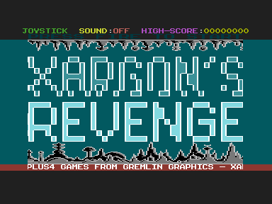

# Xargon's Revenge C16

I wrote Xargon's Revenge at Micro Projects in 1985 for the Commodore 16 and Plus/4. This project preserves my recovered disks, reassembles the surviving source and provides a baseline for studying and developing the game.


## Build and Run

I build the preserved version with Python 3.9 or later and the cc65 tools (`ca65` and `ld65`):

```sh
./build.sh
python3 scripts/run_vice.py
```

The result is `build/xargons-revenge.prg`, a 15,362-byte saved-address PRG. It loads at `$0400` and enters at `$1800` (`SYS 6144`); it has no BASIC `RUN` stub. The launcher waits for the emulated machine's reset before loading it. I use VICE `xplus4` 3.10, model `c16pal`, with 16 KB RAM.

I can also use `make`, `pio run -e c16`, or `pio run -e c16_debug`. All tested entry points produce identical program bytes. [Quick Start](QUICKSTART.md) and [Build and Run](docs/BUILD_AND_RUN.md) cover setup, VS Code and the original running program.

---

## Verified Preservation Baseline

All **8,094 bytes** recorded in the surviving `OBJ` listing match the assembled code and embedded data. The rebuild uses the 2026 disk sources and six explicitly mapped 1992 fallbacks. Graphics come from preserved standalone assets named by the original loader. I have copied no executable or graphical bytes out of the running PRG to complete this build.



The title renders and the original control flow reaches gameplay on a 16 KB PAL C16 in VICE, with sound disabled and a scripted fire flag. This verifies startup, not a complete game. Manual controls, audio, later transitions, a full play-through and real hardware remain untested.

The running reference decompresses to identical code and embedded data, but has different alien graphics in waves 5–16. Both binaries start with five lives; the packaging says three and the display shows at most three icons. I preserve that source behaviour. [Source and Validation](docs/SOURCE_AND_VALIDATION.md) explains every compared memory region and the controlled probes.

---

## Guides and Evidence

[Testing](TESTING.md) describes the regression checks and emulator evidence. [Source Inventory](docs/SOURCE_INVENTORY.md) records source priority, fallbacks and unused material. [Source and Validation](docs/SOURCE_AND_VALIDATION.md) links the machine-readable reports and retained monitor logs and memory captures.

[History and Credits](docs/HISTORY_AND_CREDITS.md) records what I remember and what the sources say. [Artifacts](docs/ARTIFACTS.md) identifies the supplied images by content. [Rights and Preservation](RIGHTS.md) preserves the historical notices without inventing a licence. [Source Workspace](src/README.md) explains the generated assembly, and [Sharing on GitHub](docs/SHARING_ON_GITHUB.md) covers releases.

[Changelog](CHANGELOG.md) records releases; [project context](CLAUDE.md) gives the concise build rules.

The original [project brief](Xargons%20Revenge%20Prompt.md) is retained unchanged as a commissioning record. It is not historical evidence about the game.

---

## Recovery Background

My original development setup and the source-recovery story are documented in [Dorks Dilemma C16](https://github.com/anthonyjclarke/Dorks_Dilemma_C16), particularly its [Development History](https://github.com/anthonyjclarke/Dorks_Dilemma_C16/blob/main/docs/DEVELOPMENT_HISTORY.md). This project adapts the actual disk reader, source converter, build and documentation tooling from that work and [Tycoon Tex](https://github.com/anthonyjclarke/Tycoon_Tex_C16). The addresses, assets and validation results here belong to Xargon's Revenge.

I confirmed on 21 October 2026 that I used the same C64 and shared-1541 development setup for all my C16 games. I was a fan of Scramble and wanted to make a scrolling game. I do not remember further collaborators or more precise completion and publication dates.
