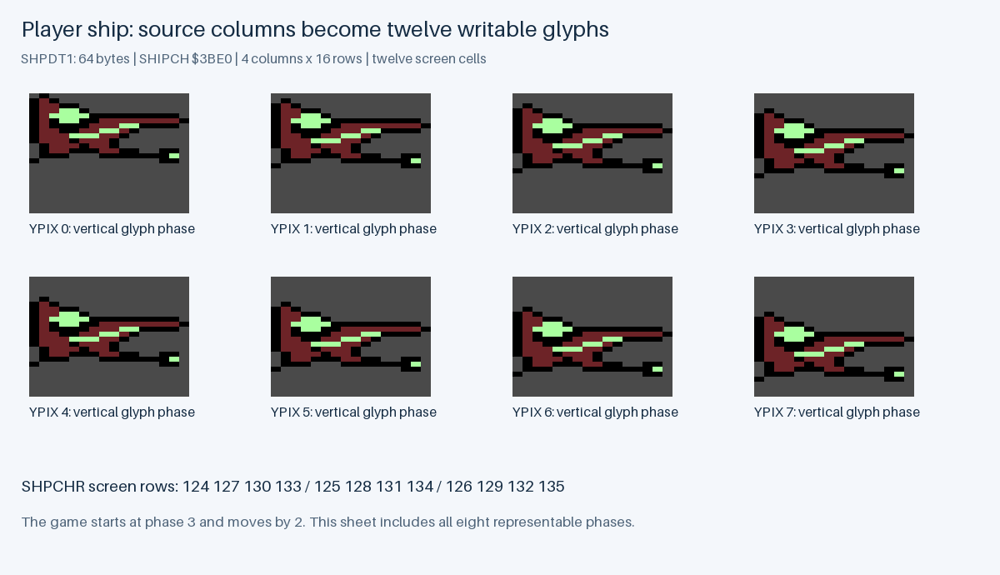
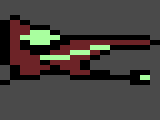
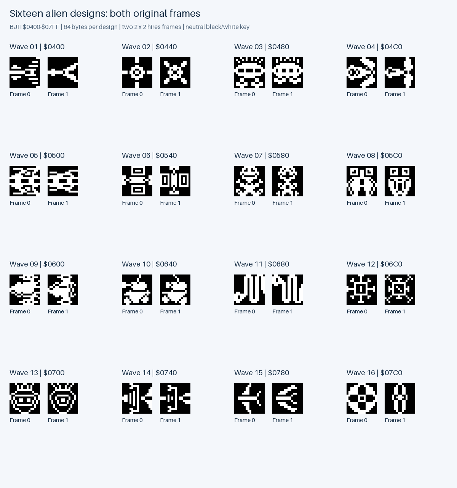
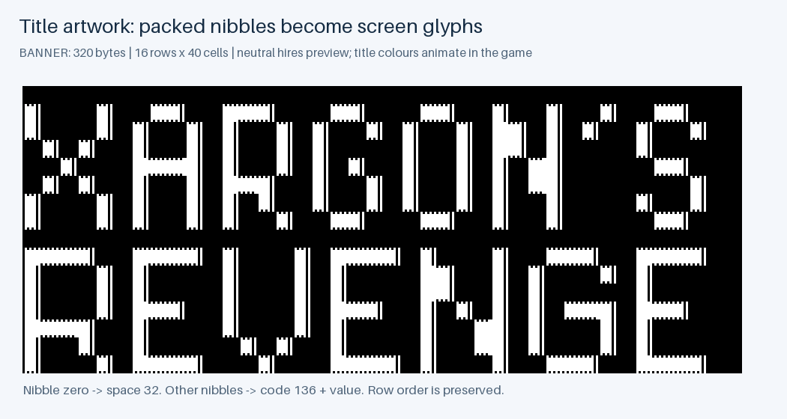
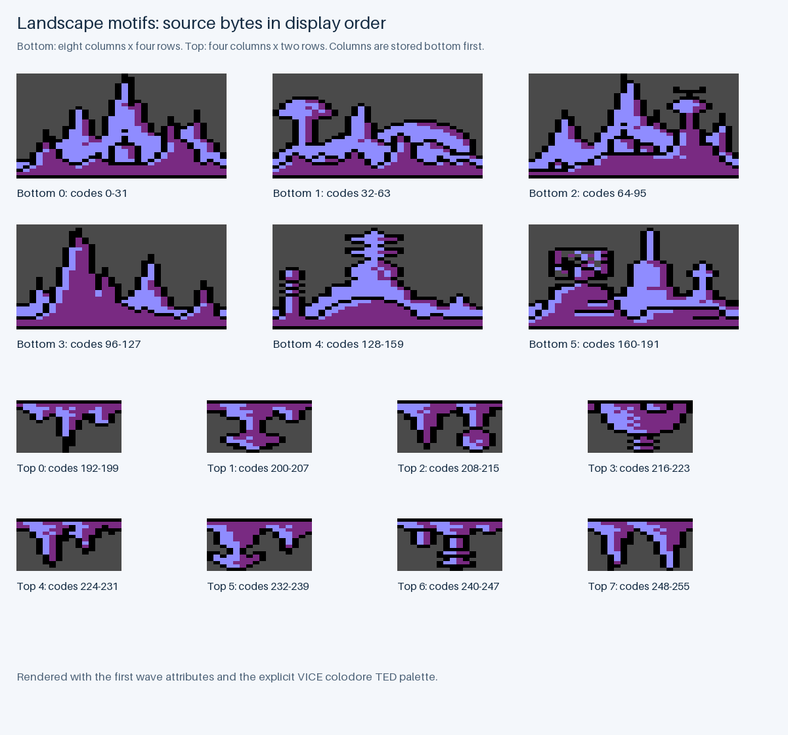
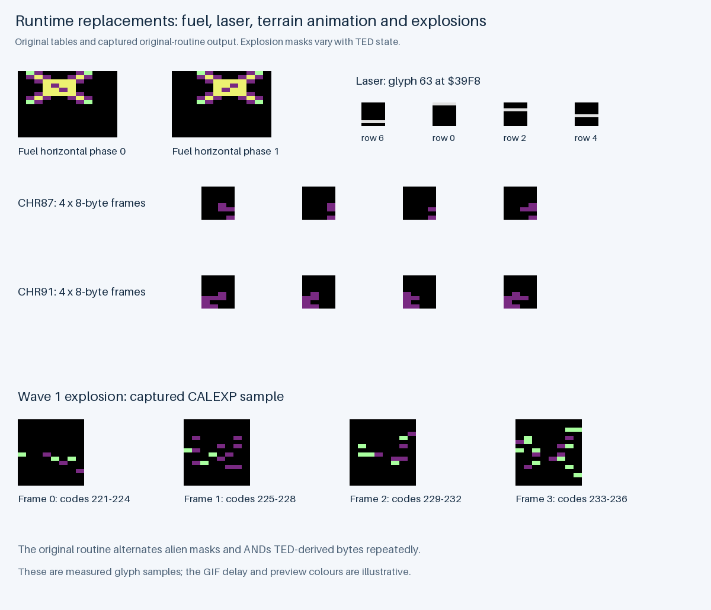
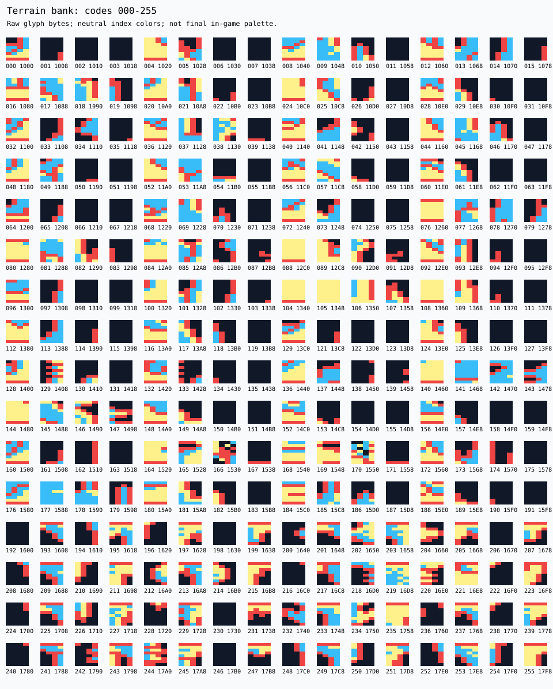
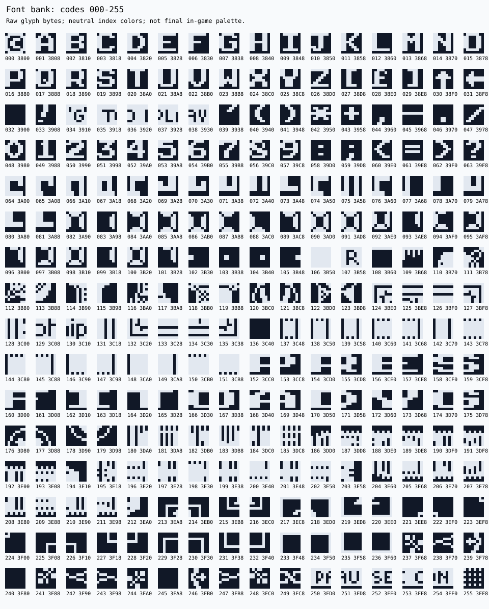
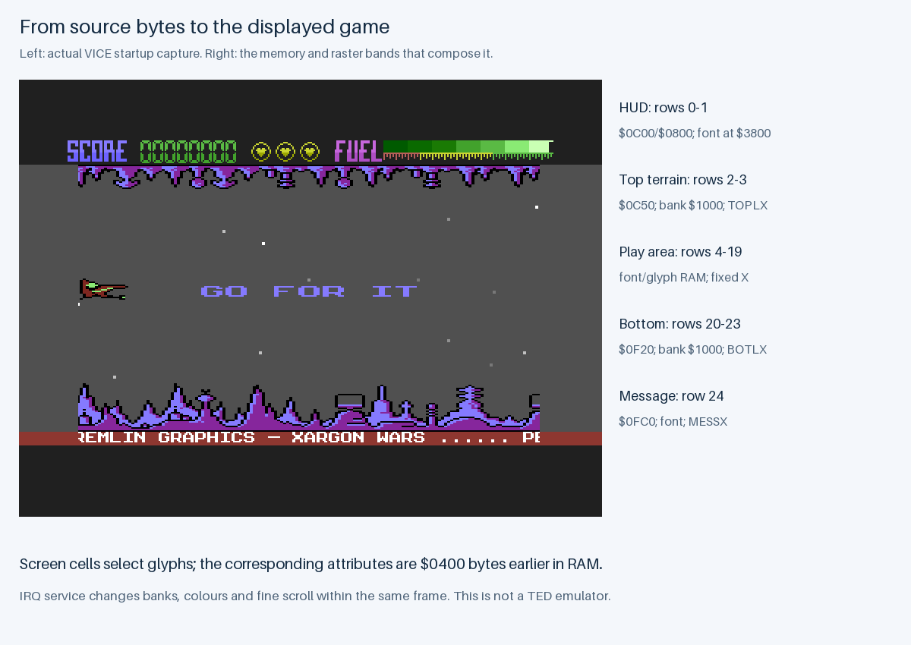

# Original Graphics and Screen Composition

## Inputs and Interpretation

I generate these references with `scripts/analyze_codebase.py` and `scripts/render_game_graphics.py`. [asset-data.json](analysis/asset-data.json) retains raw bytes, addresses, lengths, little-endian table records, source module-line references and hashes. [graphics-manifest.json](analysis/graphics/graphics-manifest.json) records the script, asset, palette, screenshot and output hashes.

The preserved banks are the loader-selected `BJH` alien pool at `$0400`, `LANDSCAPE-2` terrain at `$1000` and `FRAK!` font at `$3800`. Each glyph has eight bytes, one per row. Hires reads the high bit first across eight pixels. Multicolour reads pairs from bits 7–6 through 1–0 and doubles each pair horizontally. In a multicolour window the attribute's bit 3 selects multicolour for that cell; ordinary aliens have it clear.

The coloured assembly examples use the explicit VICE 3.10 `colodore_ted.vpl` values saved in `config/ted-palette.json`. Palette indices and table relationships come from the source. The current startup screenshots use VICE's internal default RGB colours, so I do not claim that this chosen palette matches their RGB values. Black/white and multicolour index atlases are interpretation keys, not claims about a final raster palette.

---

## Player and Enemy Frames



The ship is reconstructed from four 16-byte columns in `SHPDT1`, copied into four 24-byte columns in writable glyph RAM at `$3BE0`. `SHPCHR` places those glyphs row by row as `124,127,130,133`, then `125,128,131,134`, then `126,129,132,135`. The sheet shows all eight possible vertical offsets; ordinary startup begins at phase 3 and movement changes it by two.



This GIF cycles phases 3, 1, 7 and 5 with a 250 ms illustration delay. It is not a measured animation rate or a replay of actual movement.



Each alien design is 64 bytes: two frames of four hires glyphs. `ALIDEF` copies the selected design into `$3EA8`; `PRTALI` places its four codes in a two-by-two footprint. Sixteen source selections were checked against the original routine, with the same checks made for the running reference. That reference differs for indices 4–15. The preserved source asset supplies these illustrations.

---

## Title, Terrain and Runtime Effects



`BANNER` stores sixteen rows of twenty packed bytes. Each nibble selects a glyph at `136 + value`, while zero selects space 32. The neutral reconstruction keeps row order; the actual title scrolls rows in a random sequence and animates its colours. The [two-frame alien GIF](analysis/graphics/alien-frames.gif) likewise illustrates source frames with a 250 ms delay rather than measured game timing.



Bottom terrain consists of six eight-column, four-row motifs. Each stored column runs bottom first; the illustration reverses it into display rows. Upper terrain has eight four-column, two-row motifs at codes 192–255. The game chooses and streams these columns; the sheet is a catalogue, not a stored level map.



Fuel uses two 24-byte horizontal phases in `FUELDA`. Each comprises three eight-byte columns placed into six glyphs, with additional vertical shifting at runtime. The laser rewrites a single row of glyph 63. `LANANI` cycles four frames into terrain glyphs 87 and 91. The TV landscape effect also shifts and edits glyph bytes.

The explosion example contains output from the unchanged original `CALEXP` routine in the retained source-wave-1 probe. The asset export provides samples for all sixteen waves, with the evidence ZIP member and hashes. The masks depend on TED reads, so these captures are samples of an algorithm, not a complete fixed animation asset. No game instructions were changed to obtain them.

---

## Indexed Atlases

[Terrain hires](analysis/terrain-hires.svg), [terrain multicolour](analysis/terrain-multicolor.svg), [font hires](analysis/font-hires.svg) and [font multicolour](analysis/font-multicolor.svg) label every glyph code and address. The [terrain indexed PNG](analysis/graphics/terrain-indexed.png) and [font indexed PNG](analysis/graphics/font-indexed.png) provide raster equivalents. The font atlas is the initial bank; it includes regions that the game replaces at runtime.





---

## Composing the Screen



The screen matrix is at `$0C00`, with corresponding attributes `$0400` bytes earlier. Rows 0–1 form the HUD, rows 2–3 upper terrain, rows 4–19 the play window, rows 20–23 bottom terrain and row 24 the scrolling message. Raster services select banks, fine-scroll values and colours within the same frame.

The comparison image uses the actual verified gameplay-entry capture. It stops before a complete normal gameplay sequence, with the ready message still present. The diagrams explain how original bytes form the display; they are not an emulator or evidence of a full play-through. [Codebase Analysis](../CODEBASE_ANALYSIS.md) traces the consuming routines, and [Porting Guide](PORTING_GUIDE.md) explains what a new renderer would need to preserve.

---

## Regeneration

```sh
make docs
make docs-check
```

The analysis generator reads the verified build. Graphics additionally read the retained local explosion fixtures, palette data and verified screenshot. Generation uses hashes rather than timestamps. Freshness checking regenerates into temporary directories and compares every expected output; it does not change historical inputs or rerun a graphical emulator implicitly.

[Generated reference guide](analysis/README.md), [README](../README.md).
