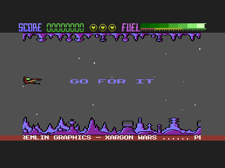

# Source and Validation

## Result – 21 October 2026

I rebuilt the surviving source and object-listing revision, using the standalone assets identified by its C16 autobooter and relocation loader. The output loads at `$0400` and enters at `$1800`. Its length is 15,362 bytes and SHA-256 is `32c13c8867ea97bb4fd60ac9a73e5d7a600c04ece5699ac37680143c12adce33`.

All 8,094 recorded object bytes at `$1800`–`$379D` match. There are no reserved gaps within that object span. This is equality with the surviving object listing, not equality with every byte of the supplied compressed PRG.

The loader calls for `FRAK!`, `LANDSCAPE-2` and `BJH`; it copies `BJH` into `$0400`–`$07FF`. I retain those binary assets. The editable terrain assembly differs from `LANDSCAPE-2` at 29 byte addresses, all recorded in [build-comparison.json](verification/build-comparison.json). I have not substituted the editable revision or attempted to repair it. It remains useful as a graphics source comparison.

---

## Source Selection and Assembly

The initial baseline records 212 supplied files, excluding `.DS_Store`. I subsequently added a byte-identical copy of the missing side 2 D64 found at the exact path recorded in the supplied capture manifest. Both disk images match their capture hashes, and every payload matches the extraction – 3 files on side 1, 94 on side 2. The 1992 ZIP and its 101-member extracted folder match byte for byte. The comparison uses a temporary extraction, never the originals.

The [input catalogue](verification/input-catalogue.json), [initial hashes](verification/original-inputs.json) and [source manifest](verification/source-manifest.json) distinguish original bytes, source normalization, active modules, graphics, comparison-only inputs and unused material. The [Source Inventory](SOURCE_INVENTORY.md) gives the six fallback mappings.

---

## Comparison with the Running Version

The supplied 9,518-byte PRG starts at `$1001` with a BASIC `SYS 4109` stub. I ran its decompressor in VICE and stopped at `$1800` before the first original game instruction. The reference code and embedded data match every source object byte. Terrain at `$1000`–`$17FF` and the font at `$3800`–`$3FFF` also match the loader-selected assets exactly.

There are 2,681 differences across the captured `$0400`–`$3FFF` span. Each address and both values are recorded in [vice-verification.json](verification/vice-verification.json): 735 in the alien graphics pool, 1,859 in screen/attribute RAM and unpacker workspace, and 87 in padding after the object listing. There are no differences in initialized code, embedded object data, terrain or the font.

The first 256 bytes of the reference alien pool match `BJH`. Its next three pages equal 256-byte slices of `BJH` beginning at offsets 1, 2 and 3 respectively, rather than the source's next complete pages. That is an observed relationship, not an explanation of how it happened. I have no evidence identifying a deliberate alternative design or the process that produced the shifted pages.

The original `ALIDEF` probes confirm the consequence: wave indices 0–3 select identical 64-byte frames, while indices 4–15 select different bytes. The default build retains the complete loader-selected `BJH` asset. A derivative must make its own explicit compatibility choice if it wants to reproduce the running reference's graphics.

The reference's screen and attribute contents are compared before initialization, so they are workspace differences rather than evidence of a different rendered screen. The 87 nonzero padding bytes contain symbol-like text beyond the end of the object region. I found no source allocation there. I have not inferred extra executable code from that text, and the rebuild zero-fills it.

---

## Emulator Evidence and Limits

The rebuilt and running-reference memory both draw the title and reach gameplay with five lives. The packaging advertises three; `PRLIVE` displays at most three icons. I retain the five-life source instruction and document the discrepancy. I do not change the preservation build to agree with the inlay.

The [rule probes](verification/rule-probes.json) record all controlled inputs and selected outputs for graphics selection, score crossings and fuel arithmetic. Both revisions have identical code and gave the same arithmetic results in these probes. The eight-digit score wraps to zero in the tested overflow; the final store uses `Y = $FF`, so this is not an overflow-safe portable arithmetic contract.

This capture stops at the main loop with the ready message still visible. It does not show active enemies or a completed wave. Manual controls, sound, transitions, a full play-through and real hardware remain pending. [Testing](../TESTING.md) explains the exact scripted input and execution limits.

---

## Retained Evidence

[Build comparison](verification/build-comparison.json), [source manifest](verification/source-manifest.json), [VICE report](verification/vice-verification.json), [routine probes](verification/rule-probes.json) and [tool checks](verification/tool-checks.json) are the concise reports. The [evidence ZIP](verification/vice-evidence.zip) retains monitor commands, invocation arguments, logs and full memory captures; [evidence-manifest.json](verification/evidence-manifest.json) gives member hashes. These are actual local captures, with original paths and cycle counters. The ZIP container uses fixed dates for stable packaging.

Build outputs and scratch files remain under ignored `build/`; the committed reports, screenshots and evidence are intentional documentation fixtures. CI results are reported separately in the release record. [README](../README.md).
